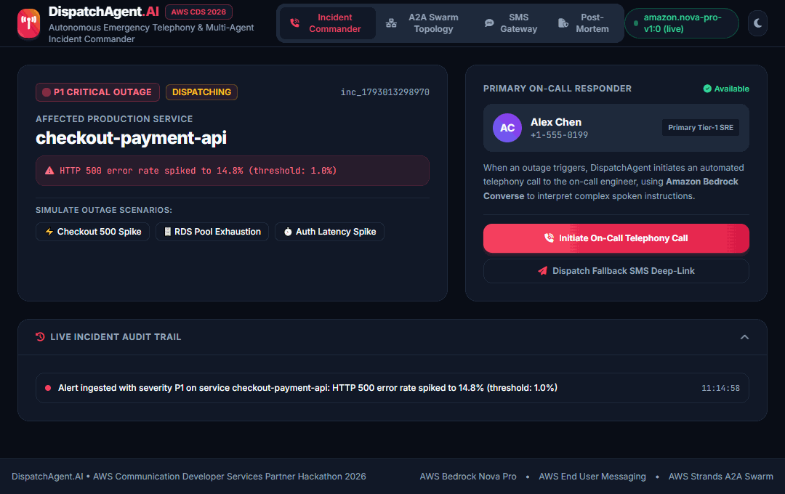
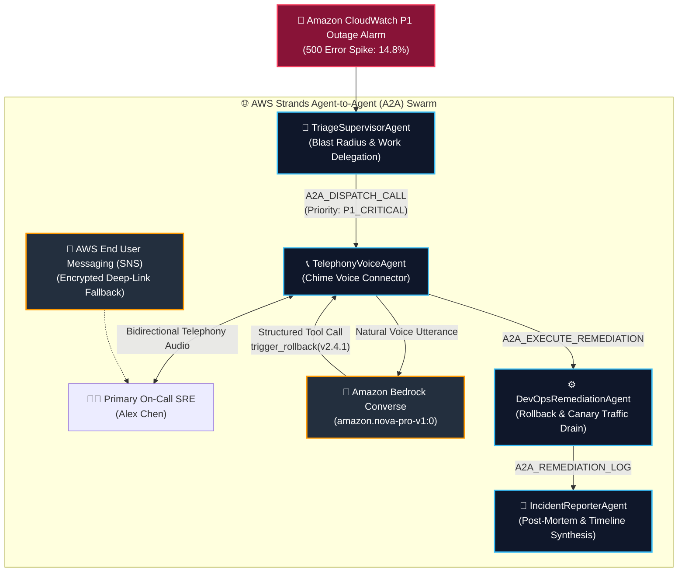
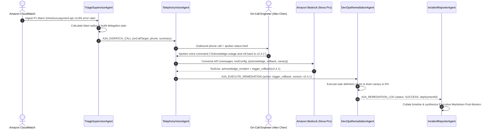

# 🚨 DispatchAgent.AI — Autonomous AWS Telephony Voice & Strands A2A Incident Response

[](https://www.typescriptlang.org)
[](https://opensource.org/licenses/MIT)
[](https://aws.amazon.com)
[](https://aws.amazon.com/bedrock/)
[](https://aws.amazon.com/chime/)
[](./test)

> **Built for the [AWS Cloud Development Series: Agentic AI Edition (Devpost)](https://aws-cds-agentic.devpost.com/)**  
> *Submission Deadline: Wednesday, October 28, 2026 @ 1:00 PM PDT*

DispatchAgent.AI is an autonomous SRE incident response swarm. When a high-priority (P1) production outage alarm fires, DispatchAgent immediately dials the on-call engineer via telephony, speaks a real-time status brief, interprets complex spoken voice instructions using **Amazon Bedrock Converse (`amazon.nova-pro-v1:0`)**, and coordinates zero-downtime remediation across an **AWS Strands Agent-to-Agent (A2A)** multi-agent mesh.

---

## 🎬 Live Interactive Walkthrough

<p align="center">
  
</p>

> **Autonomous Incident Remediation**: When a P1 outage strikes, DispatchAgent connects an on-call voice channel, invokes Amazon Bedrock Nova Pro tool calling (`trigger_rollback` to stable version `v2.4.1`), drafts an immediate post-mortem, and provides full light/dark UI accessibility.

---

## ⚡ 2026 Architecture: Strands A2A Swarm & Bedrock Converse



---

## 🔁 Real-Time Agent-to-Agent (A2A) Interaction Flow



---

## 🛠️ Core Capabilities

### 1. Amazon Bedrock Converse Voice Intent (`src/bedrock_converse_agent.ts`)
* Replaces legacy regex keywords with a real multi-tool `ConverseCommand` loop running on `amazon.nova-pro-v1:0`.
* Understands complex, natural-language spoken utterances, extracting target versions (e.g. `v2.4.1`), canary weights, and escalation directives.
* Includes an offline deterministic simulator for zero-cost reproduction when AWS credentials are not set.

### 2. AWS Strands Agent-to-Agent (A2A) Protocol (`src/a2a_orchestrator.ts`)
* Implements AWS's open 2026 A2A communication protocol.
* Structured JSON packets with typed envelopes (`A2A_ALERT_INGESTED`, `A2A_DISPATCH_CALL`, `A2A_EXECUTE_REMEDIATION`, `A2A_REMEDIATION_LOG`).
* Full correlation ID propagation allowing end-to-end trace reconstruction across distributed agents.

### 3. Outbound Telephony & Voice Connector (`src/chime_voice_orchestrator.ts`)
* Manages automated outbound telephony state (`DIALING`, `CONNECTED`, `COMPLETED`).
* Captures bidirectional speech transcripts and feeds audio into the Bedrock tool execution pipeline.
* Handles instant acknowledgment, emergency rollback, canary drainage, and escalation to secondary responders.

### 4. Automated Post-Mortem Synthesis (`IncidentReporterAgent`)
* Automatically synthesizes cross-agent telemetry into an executive Markdown post-mortem document containing exact timestamps, blast radius assessments, and root-cause analyses.

---

## 🧪 Comprehensive Verification Suite (25 Assertions)

Run the full end-to-end verification pipeline:

```bash
npm test
```

| Test Suite | Assertions | Focus Area |
| :--- | :---: | :--- |
| `verify_dispatch_agent.ts` | 7 | E2E P1 alert ingestion, telephony initiation, tool dispatch, SMS fallback, A2A logs |
| `bedrock_converse.test.ts` | 4 | Bedrock Converse tool-use loop, single & compound tool extraction, escalation |
| `eval.test.ts` | 4 | Command-understanding accuracy (1.000 F1 score across labeled voice commands) |
| `server_integration.ts` | 10 | HTTP REST API, SSE state streaming, security path-traversal guards, payload bounds |
| **Total** | **25** | **100% Passing Green Test Suite** |

---

## 🚀 Quickstart

### Prerequisites
* Node.js v20+ or v22+
* npm v10+

### 1. Installation
```bash
git clone https://github.com/akmalkhaniub/dispatch-agent-ai.git
cd dispatch-agent-ai
npm install
npm test
```

### 2. Launch Operator Dashboard
```bash
# Offline simulation mode (zero cloud cost, no AWS credentials required)
npm run dev

# Live Amazon Bedrock mode (uses ~/.aws/credentials or environment variables)
LIVE_BEDROCK=true npm run dev
```

Open [http://localhost:3003](http://localhost:3003) in your browser.

---

## 📁 Repository Structure

```
aws-cds-agentic-ai/
├── src/
│   ├── a2a_orchestrator.ts         # AWS Strands A2A multi-agent swarm & typed message bus
│   ├── bedrock_converse_agent.ts   # Amazon Bedrock Converse API tool-calling agent (Nova Pro)
│   ├── chime_voice_orchestrator.ts # Telephony session state & speech transcript processing
│   ├── incident_triage.ts          # Incident lifecycle state machine & alert ingestion
│   ├── messaging_gateway.ts        # AWS End User Messaging (SNS) SMS gateway
│   ├── server.ts                   # HTTP REST API & static web console server
│   ├── util.ts                     # Security guards & JSON helpers
│   └── public/                     # High-contrast reactive operator dashboard
├── test/
│   ├── verify_dispatch_agent.ts    # Core multi-agent flow verification
│   ├── bedrock_converse.test.ts    # Bedrock tool-calling assertions
│   ├── eval.test.ts                # Command intent accuracy benchmark
│   └── server_integration.ts       # HTTP endpoint & security regression suite
├── docs/                           # Architecture diagrams, pitch deck, submission copy
└── package.json
```

---

## 📜 License
MIT License. Open source and built for the AWS Cloud Development Series 2026.
